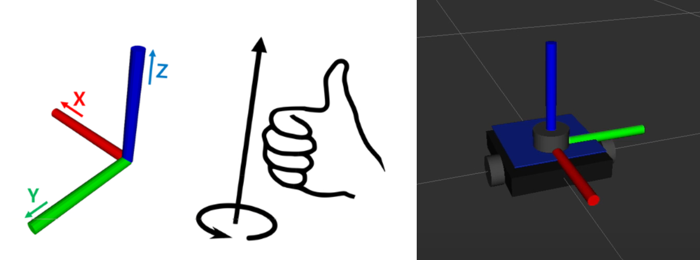

# ROS-топики

В процессе работы ровера все данные и команды передаются через ROS-топики. Они используются для обмена информацией между нодами: управления движением, получения данных с сенсоров и взаимодействия с внешними интерфейсами.

Актуальный список доступных топиков можно получить командой:

```bash
ros2 topic list
```

Для базовой конфигурации **BRover-E5** список включает следующие основные топики.

## Краткая таблица топиков

| Группа | Основные топики | Назначение |
| ------ | --------------- | ---------- |
| Камеры | `/camera1/image_raw`, `/camera1/camera_info`; для второй камеры — `/camera2/image_raw`, `/camera2/camera_info` | видеопотоки и параметры камер |
| Управление моторами | `/m_vel1` – `/m_vel6` | целевые скорости отдельных двигателей |
| Обратная связь от моторов | `/m_odom1` – `/m_odom6` | текущие скорости двигателей |
| Одометрия | `/odom_pose2d` | координаты и угол поворота ровера |
| IMU | `/bhi360/imu` | ускорения, угловые скорости и ориентация |
| Батарея | `/bat` | состояние питания и аккумулятора |
| Джойстик | `/joy` | оси и кнопки радиомодельного пульта |
| Команды движения | `/cmd_vel` | целевая линейная и угловая скорость ровера |
| Кнопки | `/user_button` | состояние кнопки питания и пользовательской кнопки |

Подробное описание каждой группы приведено ниже.

## Топики камеры

Основные топики основной USB-камеры:

```bash
/camera1/image_raw
/camera1/camera_info
```

Если подключена вторая камера, для неё используются `/camera2/image_raw` и `/camera2/camera_info`.

Дополнительные транспортные топики:

```bash
/image_raw/compressed
/image_raw/compressedDepth
/image_raw/theora
/image_raw/zstd
```

Для получения изображения и параметров камеры в первую очередь используйте `/camera1/image_raw` и `/camera1/camera_info` либо соответствующие топики второй камеры. Наличие транспортного топика в списке само по себе не подтверждает передачу изображения.

## Управление моторами

Для задания скоростей вращения каждого двигателя используются отдельные топики:

```bash
/m_vel1
/m_vel2
/m_vel3
/m_vel4
/m_vel5
/m_vel6
```

Тип сообщения:

```bash
std_msgs/msg/Float32
```

В эти топики публикуются значения скоростей, которые затем через ноду `cyphal_bridge` передаются на драйверы моторов.

Соответствие моторов:
- /m_vel1 – /m_vel3 — левая ось ровера (переднее, среднее, заднее)
- /m_vel4 – /m_vel6 — правая ось ровера (переднее, среднее, заднее)

## Обратная связь от моторов

Каждый драйвер двигателя передаёт данные о текущей скорости вращения в соответствующий топик:

```bash
/m_odom1
/m_odom2
/m_odom3
/m_odom4
/m_odom5
/m_odom6
```

Тип сообщения:

```bash
std_msgs/msg/Float32
```

Эти данные используются для анализа состояния системы и расчёта одометрии.

Соответствие одометрии:
- /m_odom1 – /m_odom3 — левая ось ровера (переднее, среднее, заднее)
- /m_odom4 – /m_odom6 — правая ось ровера (переднее, среднее, заднее)

## Одометрия робота

Положение ровера в пространстве публикуется в топик:

```bash
/odom_pose2d
```

Тип сообщения:

```bash
geometry_msgs/msg/Pose2D
```

Топик содержит координаты **x**, **y** и угол поворота **θ**, описывающие положение ровера в пространстве.



## Данные IMU

Инерциальный датчик публикует данные в топик:

```bash
/bhi360/imu
```

Тип сообщения:

```bash
sensor_msgs/msg/Imu
```

Включает ускорения, угловые скорости и ориентацию робота.

## Состояние батареи

Информация о питании доступна в топике:

```bash
/bat
```

Тип сообщения:

```bash
sensor_msgs/msg/BatteryState
```

Содержит данные о напряжении, токе и уровне заряда аккумулятора.

## Джойстик

Данные от джойстика публикуются в топик:

```bash
/joy
```

Тип сообщения:

```bash
sensor_msgs/msg/Joy
```

Используется для передачи состояния кнопок и осей управления.

## Команды движения

Команды движения ровера передаются через топик:

```bash
/cmd_vel
```

Тип сообщения:

```bash
geometry_msgs/msg/Twist
```

Топик используется для передачи целевой линейной и угловой скорости ровера. Нода `/radiolink_control` публикует в него команды, сформированные на основе данных джойстика, а нода `/control_move` подписывается на этот топик и рассчитывает скорости отдельных двигателей.

При управлении через веб-интерфейс команды движения также отправляются в `/cmd_vel` через `rosbridge_server`.

## Кнопка питания и пользовательская кнопка

Состояние кнопок ровера передаётся через топик:

```bash
/user_button
```

Тип сообщения:

```bash
cyphal_ros2_bridge/msg/PowerButtons
```

Сообщение содержит два логических поля:

* `emergency` — состояние кнопки аварийного отключения
* `user` — состояние пользовательской кнопки

## Получение информации о топиках

Для получения подробной информации о любом топике можно использовать команду:

```bash
ros2 topic info <имя_топика>
```

Например:

```bash
ros2 topic info /odom_pose2d
```

Это позволяет узнать тип сообщений, количество подписчиков и издателей, а также другие параметры топика.
